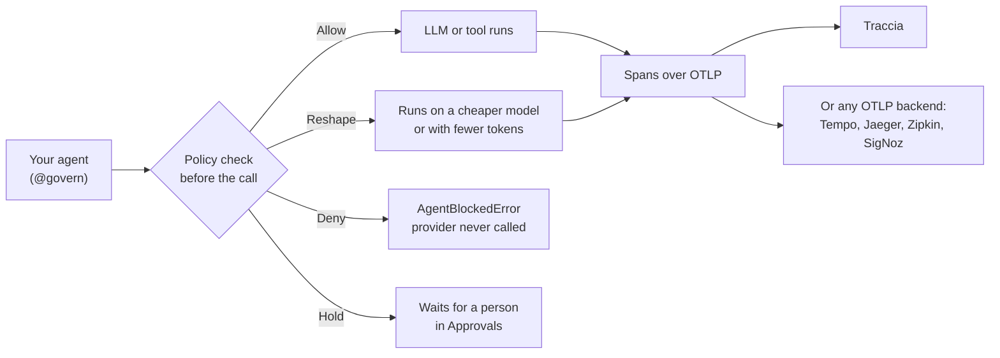

<div align="center">

# Traccia

**The AI agent control plane. Observe, evaluate, govern and prove what your agents do.**

An open-source Python SDK built on OpenTelemetry, with a hosted app for policies, evals and evidence.

[](https://pypi.org/project/traccia/)
[](https://pypi.org/project/traccia/)
[](https://pypi.org/project/traccia/)
[](LICENSE)
[](https://github.com/traccia-ai/traccia-py/stargazers)

[Docs](https://traccia.ai/docs/) · [Quickstart](https://traccia.ai/docs/sdk/quickstart/) · [TypeScript SDK](https://github.com/traccia-ai/traccia-node) · [Free account](https://app.traccia.ai/) · [Changelog](CHANGELOG.md)

</div>

- **Observe.** `init()` traces every OpenAI, Anthropic, Gemini and Groq call, with tokens and cost on each span. Send traces to Traccia or to any OTLP backend.
- **Evaluate.** Run evals from code with `evaluate()`, compare experiments, version prompts, and fail a pull request when quality, cost or latency drops.
- **Govern.** Check each LLM and tool call before it runs: stop an agent that overspends, loops or calls the wrong tool.
- **Prove.** Keep evidence for the EU AI Act and HIPAA in the Compliance Hub.

<p align="center">
  
  <br>
  <em>One agent run in Traccia: cost, tokens, every LLM and tool call, and how long each took.</em>
</p>

<!-- TODO: 20 to 30 second GIF here. An agent loops on a tool, Loop Cap blocks the next call, and the trace in Traccia shows which policy fired and why. -->

## Quickstart

No account needed for this part.

**1. Install**

```bash
pip install traccia
```

**2. Trace your first call**

```python
from openai import OpenAI
from traccia import init, observe

init(enable_console_exporter=True)  # print spans in your terminal
# init(endpoint="http://localhost:4318/v1/traces")  # or send them to Jaeger, Tempo, SigNoz...
# init()  # or to Traccia: set TRACCIA_API_KEY from app.traccia.ai

client = OpenAI()  # patched by init()

@observe()
def answer(question: str) -> str:
    resp = client.chat.completions.create(
        model="gpt-4o-mini",
        messages=[{"role": "user", "content": question}],
    )
    return resp.choices[0].message.content

answer("What is OpenTelemetry?")
```

**3. See the trace**

Each span records the model, tokens, cost, prompt, completion and latency. It prints in your terminal, shows up in your OTLP backend ([Jaeger](https://traccia.ai/docs/guides/local-jaeger/), [Grafana](https://traccia.ai/docs/guides/local-grafana/)), or appears under **Traces** in Traccia like the run above.

## Stop a runaway agent

`@observe` records what happened. `@govern` also decides whether the next call is allowed to happen. Policies live in the Traccia app, so you can change a limit without a deploy.



In the [Traccia app](https://app.traccia.ai/), create a **Loop Cap** policy with a maximum of 3 tool calls per run, set it to **Block**, and copy your API key.

```python
from traccia import init, observe, govern, AgentBlockedError

init(api_key="...", agent_id="research-agent")  # API key from app.traccia.ai

@observe(name="web_search", as_type="tool")
def web_search(query: str) -> str:
    return f"results for {query}"

@govern(name="run_agent")
def run_agent(topic: str) -> None:
    while True:  # a bug: the agent never decides it has enough
        web_search(topic)

try:
    run_agent("agent observability")
except AgentBlockedError as exc:
    # The 4th search is denied before it runs.
    print(exc.reasons, exc.decision_id)
```

The same wrapper enforces the other runtime policies. Among them:

| Policy | What it stops |
|---|---|
| [Spend Cap](https://traccia.ai/docs/platform/policies/spend-cap/) | A model call that would go over a daily, per-run or per-call USD budget. It can move the call to a cheaper model instead. |
| [Loop Cap](https://traccia.ai/docs/platform/policies/loop-cap/) | The next tool call once a run reaches the maximum you set. |
| [Model Boundary](https://traccia.ai/docs/platform/policies/model-boundary/) | A call to a model that is not on your list. It can move the call to a fallback model instead. |
| [Refund Guard](https://traccia.ai/docs/platform/policies/refund-guard/) / [Purchase Guard](https://traccia.ai/docs/platform/policies/purchase-guard/) | A refund or purchase over your limit. A middle amount can wait for a person to approve. |
| [High-Risk Tool](https://traccia.ai/docs/platform/policies/high-risk-tool/) / [Dangerous Shell Commands](https://traccia.ai/docs/platform/policies/dangerous-shell-commands/) | A tool you name, such as `delete_account`, or a shell command containing text you list, such as `rm -rf`. |

Also real time, SDK only: Freshness Guard, Retrieval Completeness, Unique Customer Cap and Prompt Pin. All policies: [traccia.ai/docs/platform/policies](https://traccia.ai/docs/platform/policies/).

Each policy runs in one of three modes: Observe logs a match, Warn alerts, and Block stops the call. You can start in Observe, see what it would have stopped, then switch to Block. The Decision Log in the app shows the decision for every call.

If Traccia can't be reached, the check blocks the call by default. You can let calls through instead under **Settings → Policy Enforcement**, or locally with `init(policy_fail_mode="open")`. See [Governance in the SDK](https://traccia.ai/docs/sdk/governance/).

## What needs an account

| | Without an account | With a Traccia account |
|---|---|---|
| Tracing, tokens and cost on each span | Yes, to the console or any OTLP backend | Yes |
| Auto-instrumentation and framework integrations | Yes | Yes |
| Runtime policies (`@govern`) | No | Yes |
| Prompt registry (`load_prompt`) and saved experiments | No | Yes |
| Human approval, the Gateway, the Compliance Hub | No | On paid plans |

There is a free plan. See [pricing](https://traccia.ai/pricing/).

## Works with

- **Model SDKs, patched automatically:** OpenAI, Anthropic, Gemini (`google-genai`), Groq
- **Agent frameworks:** [LangChain](https://traccia.ai/docs/integrations/langchain/), [CrewAI](https://traccia.ai/docs/integrations/crewai/), [OpenAI Agents SDK](https://traccia.ai/docs/integrations/openai-agents/)
- **Coding agents, traced without the SDK:** [Claude Code](https://traccia.ai/docs/integrations/claude-code/), [Cursor](https://traccia.ai/docs/integrations/cursor/), [GitHub Copilot](https://traccia.ai/docs/integrations/github-copilot/)
- **No SDK at all:** point an OpenAI, Anthropic or Gemini client at the [Traccia Gateway](https://traccia.ai/docs/platform/gateway/), and Spend Cap and Model Boundary still apply

## Fail a pull request on a bad eval

`traccia eval` fails the CI job when quality, cost or latency misses the bar you set. See [CI evals](https://traccia.ai/docs/guides/ci-evals/) and the [GitHub Action](https://github.com/traccia-ai/traccia-eval-action).

## Docs

| Topic | Where |
|---|---|
| Install and first trace | [Quickstart](https://traccia.ai/docs/sdk/quickstart/) |
| `@observe`, spans, async, errors | [The observe decorator](https://traccia.ai/docs/sdk/observe-decorator/) |
| `@govern`, policy checks, fail mode | [Governance in the SDK](https://traccia.ai/docs/sdk/governance/) |
| Guardrail detection | [Guardrails](https://traccia.ai/docs/sdk/guardrails/) |
| `evaluate()` and experiments | [Evaluate](https://traccia.ai/docs/sdk/evaluate/) |
| `load_prompt` and the prompt registry | [Prompts](https://traccia.ai/docs/sdk/prompts/) |
| Cost estimation and pricing overrides | [Pricing](https://traccia.ai/docs/sdk/pricing/) |
| OpenTelemetry metrics | [Metrics](https://traccia.ai/docs/sdk/metrics/) |
| Multi-agent services and parallel runs | [Multi-agent](https://traccia.ai/docs/guides/multi-agent/) · [Parallel runs](https://traccia.ai/docs/guides/parallel-runs/) |
| `traccia.toml` and environment variables | [Configuration](https://traccia.ai/docs/reference/configuration/) |
| `traccia doctor`, `check`, `pricing`, `eval` | [CLI](https://traccia.ai/docs/reference/cli/) |
| Full API | [Python SDK reference](https://traccia.ai/docs/reference/python-sdk/) |
| Something not working | [Troubleshooting](https://traccia.ai/docs/guides/troubleshooting/) |
| Docs for your coding agent | [traccia.ai/llms.txt](https://traccia.ai/llms.txt) |

## Contributing

Bug fixes, integrations and examples are welcome. See [CONTRIBUTING.md](CONTRIBUTING.md), and open an [issue](https://github.com/traccia-ai/traccia-py/issues) or a [discussion](https://github.com/traccia-ai/traccia-py/discussions) first for anything large.

```bash
git clone https://github.com/traccia-ai/traccia-py.git
cd traccia-py
python -m venv venv && source venv/bin/activate
pip install -e ".[dev]"
pytest tests/ -v
```

If Traccia caught a bad call for you, a star helps other people find it.

> ### Read this far? Come build Traccia with us.
>
> If you want to work on Traccia full time, skip the cover letter. Email **[founder@traccia.ai](mailto:founder@traccia.ai)** with one specific thing: a trace the SDK got wrong, a policy you needed and couldn't build, or a part of this code you would rewrite and how.
>
> "I'm passionate about AI" gets archived. A link to your pull request gets a reply.

## License

[Apache 2.0](LICENSE). Built on [OpenTelemetry](https://opentelemetry.io/).
